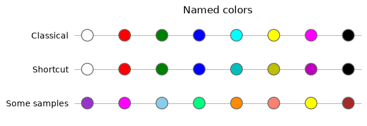
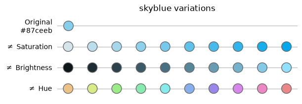
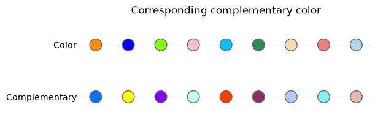
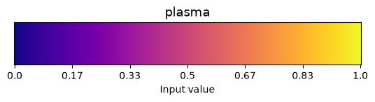
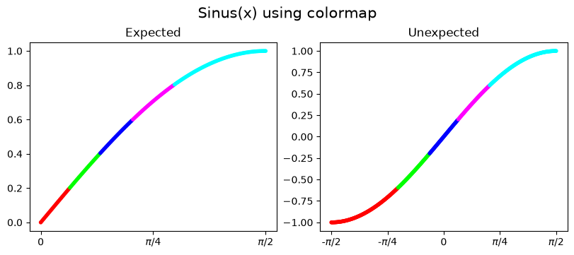
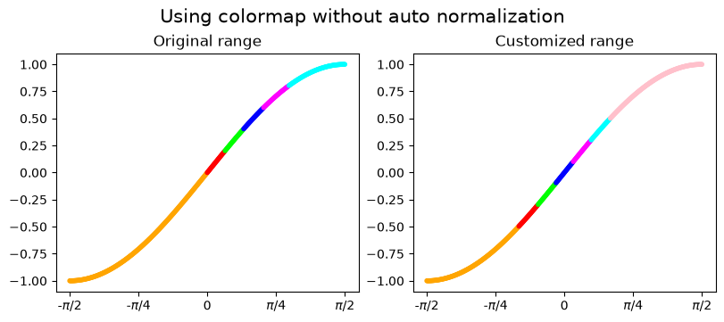
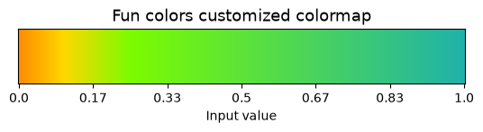

# Matplotlib Colors Tutorial

A short, hands-on Jupyter notebook about **colors and colormaps in Matplotlib**.

👉 Notebook: [`MatplotlibColorsTuto_EN.ipynb`](MatplotlibColorsTuto_EN.ipynb)

## Contents

### Part A – Colors in Matplotlib

- Representing RGB colors as `(r, g, b)` tuples in `[0, 1]` or as hexadecimal strings
- Named colors and their one-letter shortcuts (and why `'y'` is not the same as `'yellow'`)
- The HSV representation: hue, saturation and value (brightness)
- Computing variations of a color (hue, saturation, brightness)
- Computing complementary colors







### Part B – Colormaps

A colormap maps a number between 0 and 1 to a color. The notebook covers:

- **`ListedColormap`**: defined by a list of colors
  - building your own, or using built-in ones (e.g. `plasma`)
  - reducing the number of colors with `.resampled()`
  - modifying only some colors of an existing colormap
  - how automatic normalization affects the rendering, and how to control it with `Normalize` and `with_extremes(bad, under, over)`
- **`LinearSegmentedColormap`**: gradients computed by linear interpolation between colors
  - evenly spaced colors vs. custom color positions
  - limiting the number of output colors with `N`









## Helper functions

The notebook defines a few small utilities reused throughout the tutorial:

| Function | Purpose |
|----------|---------|
| `show_color` | Display one or several lists of colors as rows of dots |
| `compute_color_variation` | Generate variations of a color by hue, saturation or value |
| `get_complementary_color` | Return the complementary color (hue shifted by 0.5) |
| `draw_color_map` | Draw a colormap as a horizontal gradient bar |

## Requirements

- Python 3.9+
- [Matplotlib](https://matplotlib.org/) (a recent version is recommended: the notebook uses `Colormap.with_extremes` and `Colormap.resampled`)
- [NumPy](https://numpy.org/)
- Jupyter (Notebook, JupyterLab or VS Code)

```bash
pip install matplotlib numpy jupyter
```

## Usage

```bash
git clone <your-repository-url>
cd <your-repository-folder>
jupyter notebook MatplotlibColorsTuto_EN.ipynb
```

## Going further

- [Matplotlib – Specifying colors](https://matplotlib.org/stable/users/explain/colors/colors.html)
- [Matplotlib – Choosing colormaps](https://matplotlib.org/stable/users/explain/colors/colormaps.html)
- [Matplotlib – Creating colormaps](https://matplotlib.org/stable/users/explain/colors/colormap-manipulation.html)

## License

MIT
